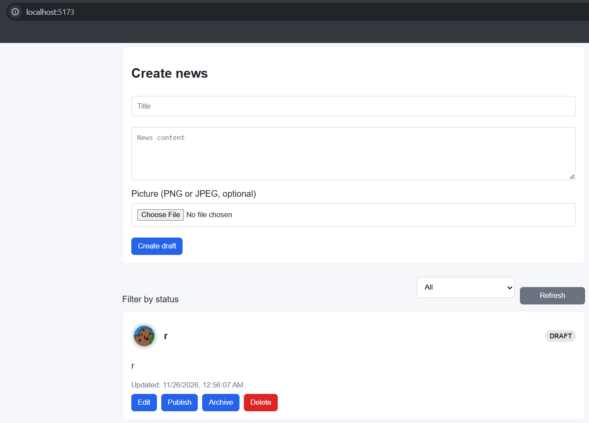

# Homework 13: avatar-service on Kubernetes

## Part 1: the image

```
$ docker image ls avatar-service
REPOSITORY       TAG   IMAGE ID       CREATED         SIZE
avatar-service   1.0   058ca5b3af0f   2 seconds ago   352MB

$ minikube image ls | grep avatar-service
docker.io/library/avatar-service:1.0
```

minikube runs its own container runtime (containerd) with its own image store, separate from Docker Desktop's. There is no registry it could pull `avatar-service:1.0` from, so `minikube image load` copies the image in.

With `:latest` and no explicit pull policy, Kubernetes uses `imagePullPolicy: Always` and tries to pull `docker.io/library/avatar-service:latest` from Docker Hub on every start. That image does not exist, so the pod ends in `ImagePullBackOff` even though the image is on the node. `:latest` also hides which version is running. I saw this myself: `up.sh` rebuilt `student-news-frontend:1.0`, but the manifest did not change, so `apply` said `unchanged` and the old pods kept the old image until `kubectl rollout restart`. A new version needs a new tag.

## Part 2: the manifest

`k8s/05-avatar-service.yaml`, both objects in the `student-news` namespace.

Deployment:
- `replicas: 1`: one pod (see Part 3).
- `selector.matchLabels: app: avatar-service` must match `template.metadata.labels`; this is how the Deployment finds its pods.
- `image: avatar-service:1.0` with `imagePullPolicy: IfNotPresent`: use the image loaded into minikube, pull only if it is missing.
- `containerPort: 8090`: the port Spring Boot listens on.
- `securityContext`: `runAsNonRoot`, `runAsUser/runAsGroup: 10001` (the `app` user from the Dockerfile) and `allowPrivilegeEscalation: false`, so Kubernetes refuses to run the container as root.

Service: `ClusterIP` on port 8090, `targetPort: 8090`, selecting `app: avatar-service`. It gives the pod a stable name inside the cluster; from the laptop it is reached with `kubectl port-forward`.

`k8s/up.sh` now also builds `avatar-service:1.0`, loads it into minikube and waits for its rollout.

The Deployment creates a ReplicaSet, which creates the pods. They are linked by the `app: avatar-service` label and selector, and each object has an `ownerReference` to its parent. The `pod-template-hash` label tells the ReplicaSets of different versions apart, as in the pod name `avatar-service-5bcd894688-sx7l6`.

From `kubectl apply` to a running container: kubectl sends the manifest to the API server, which validates it and stores it in etcd. The controller manager creates the ReplicaSet and then the Pod. The scheduler assigns the Pod to a node. The kubelet on that node starts the container through containerd and reports its status. kube-proxy routes the Service to the Pod.

## Part 3: proof

```
$ kubectl get deployment,pods,svc -n student-news
NAME                             READY   UP-TO-DATE   AVAILABLE   AGE
deployment.apps/avatar-service   1/1     1            1           21m
deployment.apps/backend          2/2     2            2           6d14h
deployment.apps/db               1/1     1            1           6d14h
deployment.apps/frontend         2/2     2            2           6d14h

NAME                                  READY   STATUS    RESTARTS      AGE
pod/avatar-service-5bcd894688-sx7l6   1/1     Running   0             21m
pod/backend-779cd9589d-6sszl          1/1     Running   0             11m
pod/backend-779cd9589d-8h697          1/1     Running   0             11m
pod/db-6b55b998cb-8725x               1/1     Running   1 (32m ago)   6d14h
pod/frontend-7788c6bd86-xzhxf         1/1     Running   0             11m
pod/frontend-7788c6bd86-zvh27         1/1     Running   0             11m

NAME                     TYPE        CLUSTER-IP       EXTERNAL-IP   PORT(S)    AGE
service/avatar-service   ClusterIP   10.106.25.94     <none>        8090/TCP   21m
service/backend          ClusterIP   10.99.157.90     <none>        8080/TCP   6d14h
service/db               ClusterIP   10.110.245.122   <none>        5432/TCP   6d14h
service/frontend         ClusterIP   10.100.211.239   <none>        8080/TCP   6d14h
```

```
$ ./avatar-service/smoke-test.sh
Smoke-testing avatar-service at http://localhost:8090
ok    GET /health -> 200
ok    POST /avatars/smoke-test-488 -> 201
ok    GET /avatars/smoke-test-488 -> 200
ok    downloaded image matches the upload byte for byte
ok    DELETE /avatars/smoke-test-488 -> 204
ok    GET /avatars/smoke-test-488 after delete -> 404
PASS: avatar-service at http://localhost:8090 works
```



```
$ kubectl get pods -A
NAMESPACE      NAME                               READY   STATUS    RESTARTS      AGE
kube-system    coredns-559f6c778d-tmbz8           1/1     Running   2 (32m ago)   6d14h
kube-system    etcd-minikube                      1/1     Running   2 (32m ago)   6d14h
kube-system    kindnet-4cvpg                      1/1     Running   2 (32m ago)   6d14h
kube-system    kube-apiserver-minikube            1/1     Running   2 (32m ago)   6d14h
kube-system    kube-controller-manager-minikube   1/1     Running   2 (32m ago)   6d14h
kube-system    kube-proxy-vpzs2                   1/1     Running   2 (32m ago)   6d14h
kube-system    kube-scheduler-minikube            1/1     Running   2 (32m ago)   6d14h
kube-system    storage-provisioner                1/1     Running   5 (32m ago)   6d14h
student-news   avatar-service-5bcd894688-sx7l6    1/1     Running   0             21m
student-news   backend-779cd9589d-6sszl           1/1     Running   0             11m
student-news   backend-779cd9589d-8h697           1/1     Running   0             12m
student-news   db-6b55b998cb-8725x                1/1     Running   1 (32m ago)   6d14h
student-news   frontend-7788c6bd86-xzhxf          1/1     Running   0             11m
student-news   frontend-7788c6bd86-zvh27          1/1     Running   0             12m

$ kubectl get pods
No resources found in default namespace.
```

`kubectl get pods` without `-n` looks only in the `default` namespace. Our pods are in `student-news`. `-A` shows every namespace, including `kube-system`, where the control plane itself runs as pods: etcd, API server, controller manager, scheduler and kube-proxy.

### Deleting the pod

```
$ kubectl delete pod -n student-news -l app=avatar-service
pod "avatar-service-5bcd894688-sx7l6" deleted

$ kubectl get pods -n student-news -w
NAME                              READY   STATUS    RESTARTS      AGE
avatar-service-5bcd894688-sx7l6   1/1     Running   0             24m
...
avatar-service-5bcd894688-sx7l6   1/1     Terminating   0             24m
avatar-service-5bcd894688-k4jxb   0/1     Pending       0             0s
avatar-service-5bcd894688-k4jxb   0/1     ContainerCreating   0             0s
avatar-service-5bcd894688-sx7l6   0/1     Error               0             24m
avatar-service-5bcd894688-k4jxb   1/1     Running             0             1s
```

The ReplicaSet saw 0 pods instead of 1 and created a new one, `k4jxb`, with the same hash `5bcd894688` because the template did not change. It was Running within a second, because the image was already on the node. The old pod shows `Error` only because the JVM exits with code 143 when it is stopped with SIGTERM. The post is still there, because it is stored in Postgres on a PersistentVolumeClaim. The picture is gone: it was a file in the old container's filesystem, and the new container starts empty. With two replicas it would be worse even without deleting anything. Each pod would have its own files, and the Service would send the upload to one pod and the download to the other, which answers 404.

### A bad tag

With `image: avatar-service:9.9`:

```
$ kubectl get pods -n student-news -l app=avatar-service
NAME                              READY   STATUS             RESTARTS   AGE
avatar-service-5bcd894688-k4jxb   1/1     Running            0          2m49s
avatar-service-6df7b75857-88zbn   0/1     ImagePullBackOff   0          16s

$ kubectl describe pod -n student-news avatar-service-6df7b75857-88zbn
Events:
  Type     Reason     Age               From               Message
  ----     ------     ----              ----               -------
  Normal   Scheduled  16s               default-scheduler  Successfully assigned student-news/avatar-service-6df7b75857-88zbn to minikube
  Normal   BackOff    16s               kubelet            Back-off pulling image "avatar-service:9.9"
  Warning  Failed     16s               kubelet            Error: ImagePullBackOff
  Normal   Pulling    4s (x2 over 17s)  kubelet            Pulling image "avatar-service:9.9"
  Warning  Failed     3s (x2 over 16s)  kubelet            Failed to pull image "avatar-service:9.9": failed to pull and unpack image "docker.io/library/avatar-service:9.9": failed to resolve reference "docker.io/library/avatar-service:9.9": pull access denied, repository does not exist or may require authorization: server message: insufficient_scope: authorization failed
  Warning  Failed     3s (x2 over 16s)  kubelet            Error: ErrImagePull

$ kubectl logs -n student-news avatar-service-6df7b75857-88zbn
Error from server (BadRequest): container "avatar-service" in pod "avatar-service-6df7b75857-88zbn" is waiting to start: trying and failing to pull image
```

Back to `avatar-service:1.0`:

```
$ kubectl apply -f k8s/05-avatar-service.yaml
deployment.apps/avatar-service configured
$ kubectl rollout status deployment/avatar-service -n student-news
deployment "avatar-service" successfully rolled out
$ kubectl get pods -n student-news -l app=avatar-service
NAME                              READY   STATUS        RESTARTS   AGE
avatar-service-5bcd894688-k4jxb   1/1     Running       0          2m55s
avatar-service-6df7b75857-88zbn   0/1     Terminating   0          22s
```

The image does not exist on the node, so the kubelet tries to pull it from Docker Hub and fails (`ErrImagePull`, then `ImagePullBackOff`). The old pod kept running, because a rolling update only removes it once the new pod is ready. `kubectl logs` has nothing to show: the container was never started, so it never wrote a log. The answer is in the Events of `describe`. The new tag changed the pod template, so the Deployment made a new ReplicaSet (`6df7b75857`) next to the old one (`5bcd894688`). After setting the tag back to `1.0` and applying again, the template matched the old ReplicaSet again. The bad pod was removed, and the Deployment was back to one Running pod.
